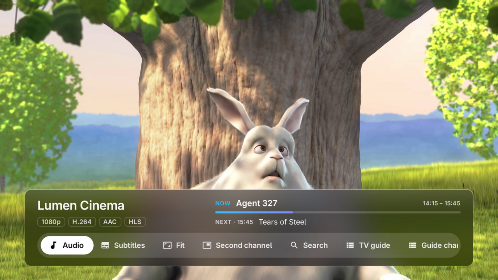
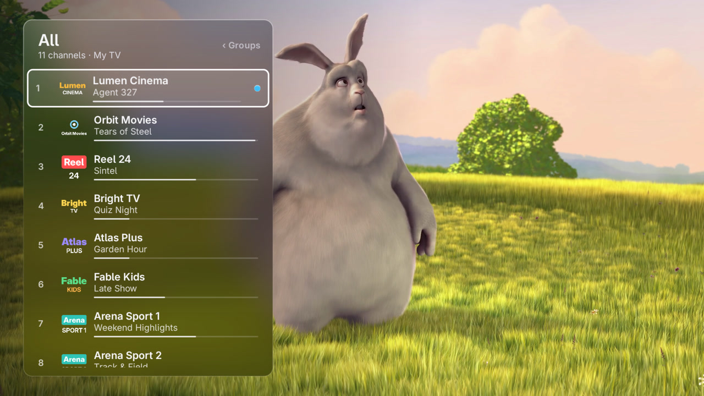
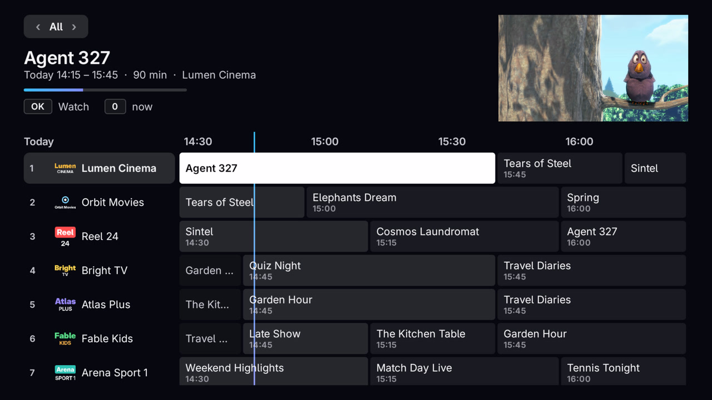
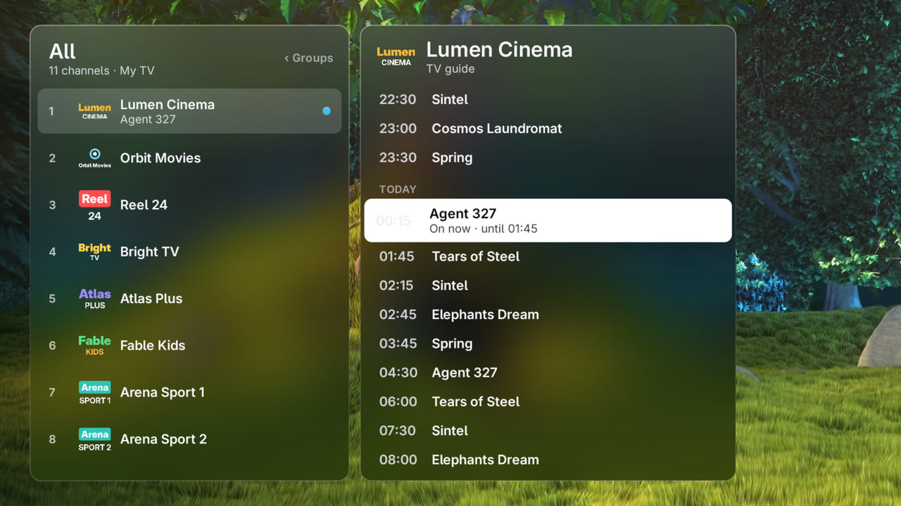
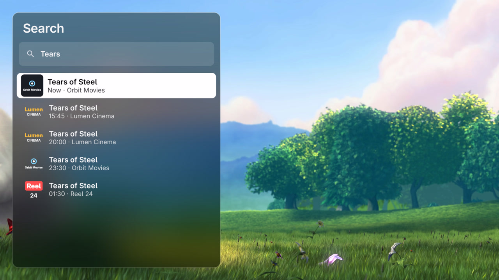
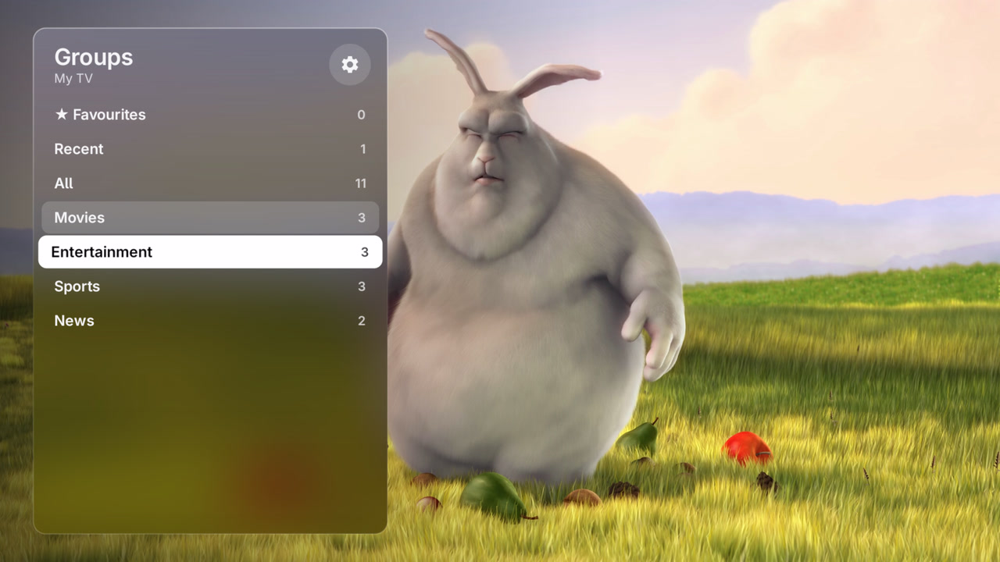
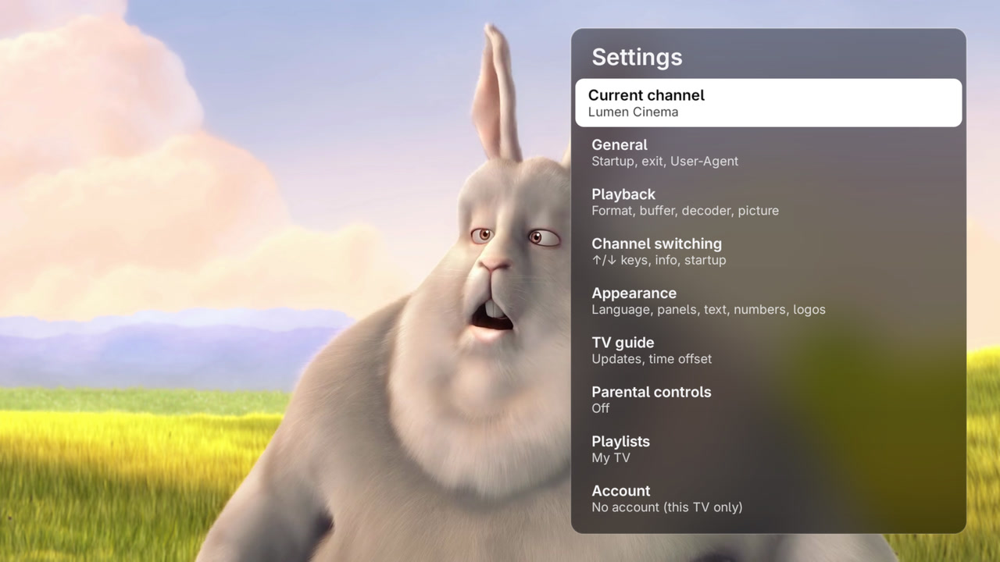
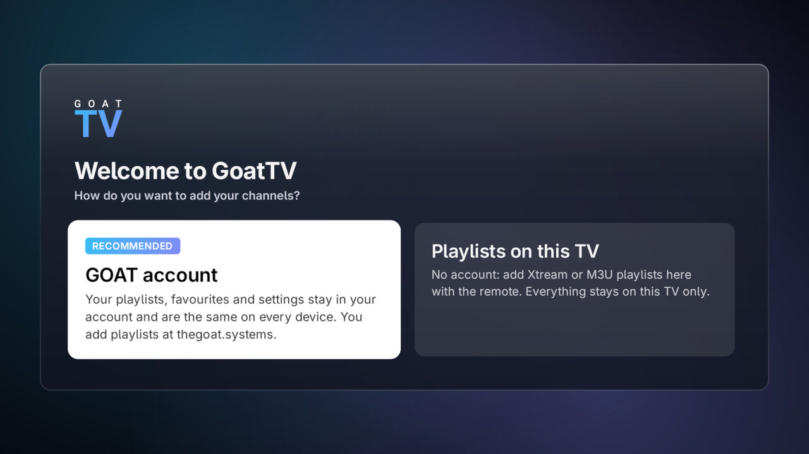

# GoatTV


Live TV player for Android TV, Google TV and Apple TV.

GoatTV does not include, sell or link to any channels or playlists. Each person adds their own
Xtream Codes or M3U lists, either on the TV or in a GOAT account.

## Screenshots

| | |
|---|---|
|  |  |
|  |  |
|  |  |
|  |  |

Screenshots use a demo playlist with made-up channels. Video: Big Buck Bunny, © Blender Foundation
(CC BY 3.0), [peach.blender.org](https://peach.blender.org).

## Install

### Android TV and Google TV

Latest version: https://github.com/GOAThings/GoatTV/releases/latest/download/goattv.apk

On the TV, open the [Downloader](https://www.aftvnews.com/downloader/) app and enter the code **8269333**.

Once installed, the app finds new versions by itself (Settings → Update).

### Apple TV

Latest version: https://github.com/GOAThings/GoatTV/releases/latest/download/GoatTV.ipa

The IPA is unsigned: sign it with your own certificate and sideload it (tvOS 17 or newer). The app tells you
when a newer version is out (Settings → Update), but you install it the same way again.

Both apps share the same GOAT account, playlists, favourites and settings.

## Build

The Apple TV app is in [`tvos/`](tvos) (Swift, built with Xcode; see its README). The Android TV app needs
Android Studio (for the Android SDK and JDK).

```bash
./gradlew assembleDebug
```

Release builds are signed with a key that is not part of this repository.

## License

GoatTV is free software under the [GNU General Public License v3.0](LICENSE).

The license covers the code only. The names "GOAT" and "GoatTV" and their logos are not licensed:
forks must use their own name and artwork.

Third-party: [Adwaita Sans](third_party/adwaita-sans-OFL.txt) (SIL Open Font License 1.1). The Apple TV app also
uses [VLCKit](https://code.videolan.org/videolan/VLCKit) (LGPL 2.1).
