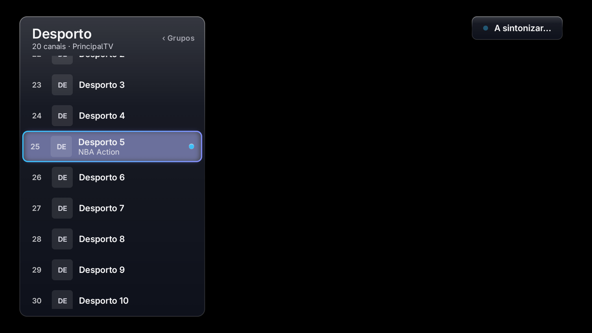
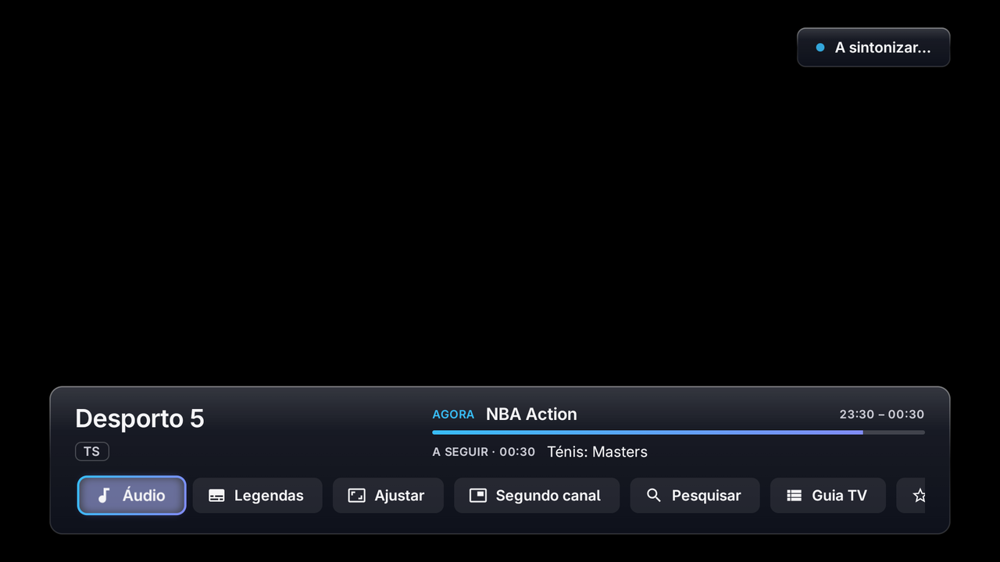
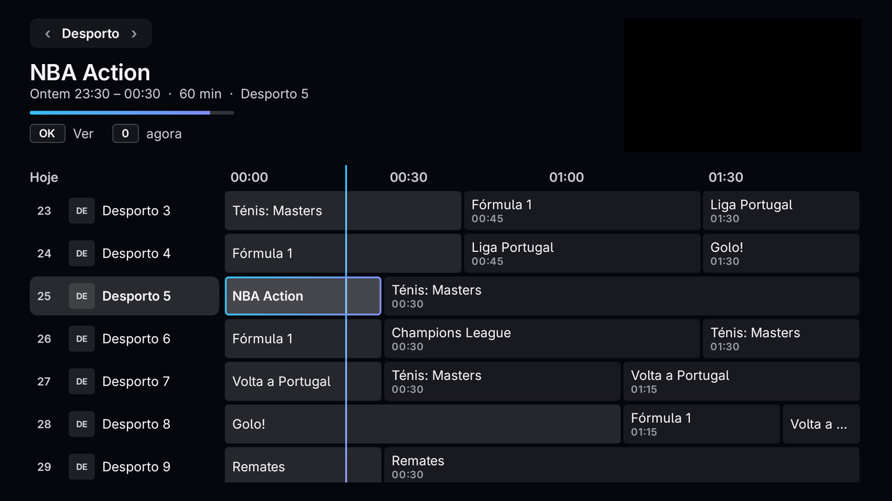
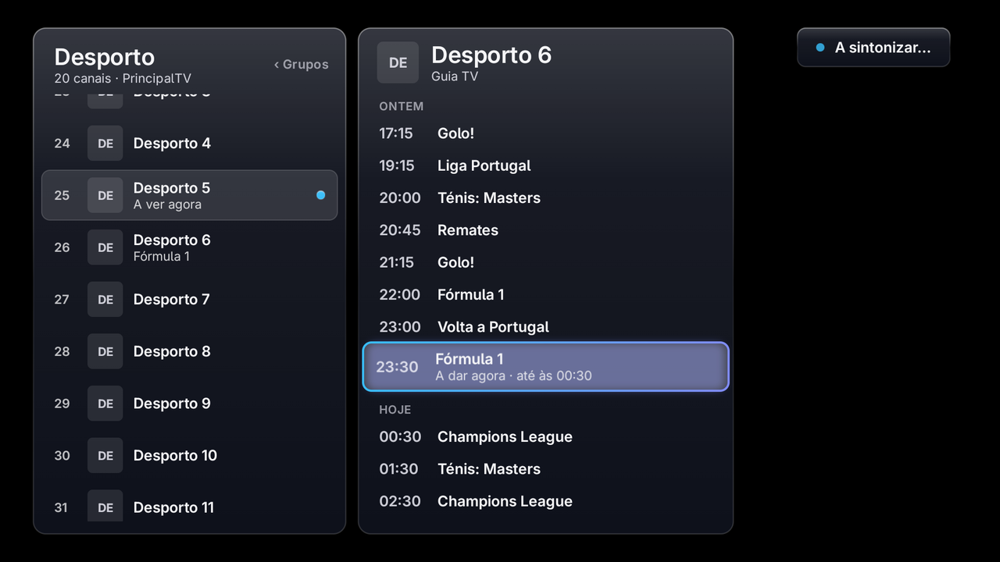
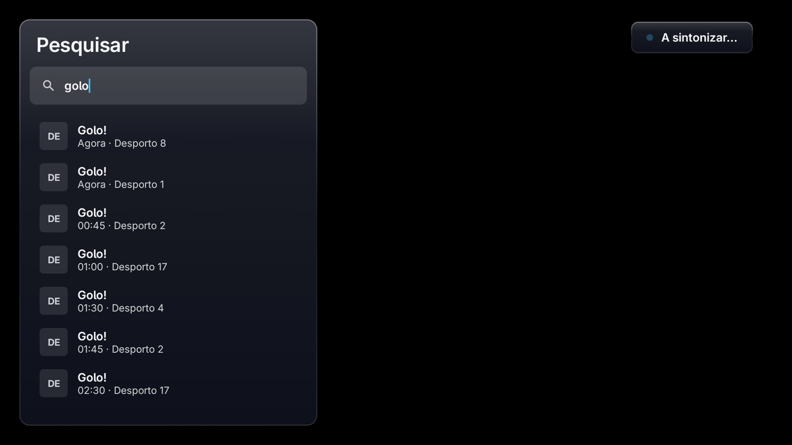
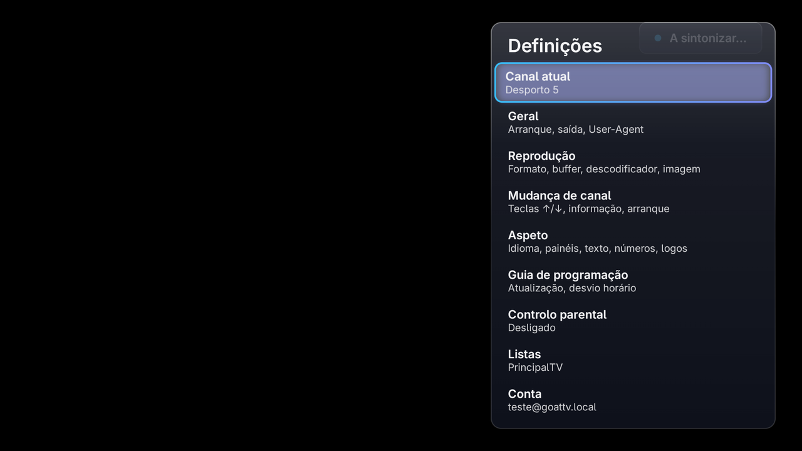

# GoatTV


Live TV player for Android TV and Google TV boxes.

GoatTV does not include, sell or link to any channels or playlists. Each person adds their own
Xtream Codes or M3U lists, either on the TV or in a GOAT account.

## Screenshots

| | |
|---|---|
|  |  |
|  |  |
|  |  |

## Install

Latest version: https://github.com/GOAThings/GoatTV/releases/latest/download/goattv.apk

On the TV, open the [Downloader](https://www.aftvnews.com/downloader/) app and enter the code **8269333**.

Once installed, the app finds new versions by itself (Settings → Update).

## Build

Needs Android Studio (for the Android SDK and JDK).

```bash
./gradlew assembleDebug
```

Release builds are signed with a key that is not part of this repository.

## License

GoatTV is free software under the [GNU General Public License v3.0](LICENSE).

The license covers the code only. The names "GOAT" and "GoatTV" and their logos are not licensed:
forks must use their own name and artwork.

Third-party: [Adwaita Sans](third_party/adwaita-sans-OFL.txt) (SIL Open Font License 1.1).
